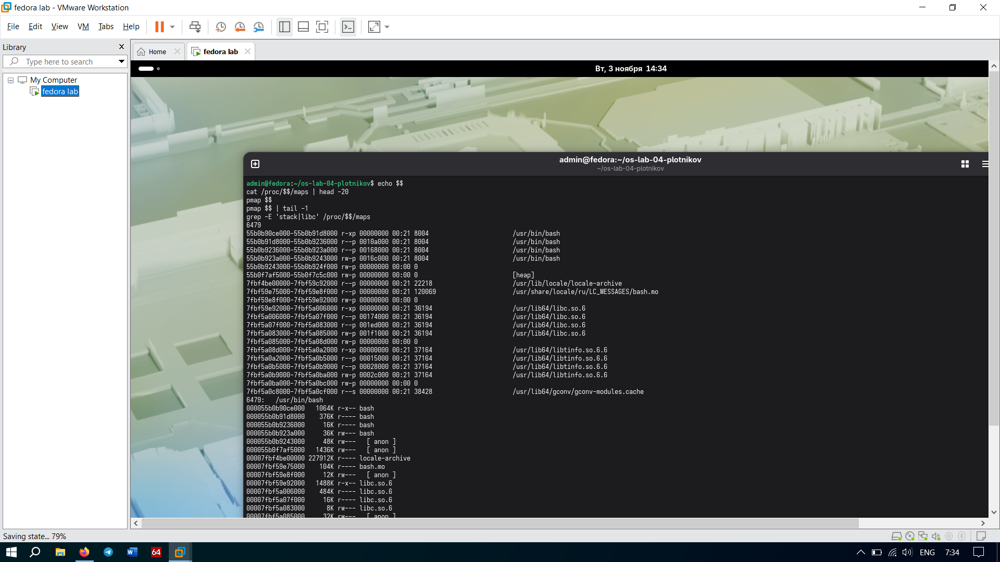

# Задание 1. Карта памяти процесса

## Что выкупили
В выводе `pmap $$` видно, из чего состоит память нашей оболочки (`bash`). 
Там есть:
*   Сам исполняемый файл `bash` (код проги).
*   Системная библиотека `libc.so.6` (база для работы Си-шных функций).
*   `[heap]` — куча (сюда сваливается динамическая память).
*   `[stack]` — стек (тут хранятся локальные переменные и вызовы функций).

Общий размер виртуальной памяти, который показал `pmap $$ | tail -1`, составил **6479 K** (около 6.3 МБ).

## Отвечаем на вопросы
**Почему одна и та же библиотека libc есть в памяти десятков процессов, но в ОЗУ лежит в одном экземпляре?**
Бро, тут работает тема с Shared Libraries (разделяемыми библиотеками). Физически код `libc` загружается в оперативку всего один раз. Виртуальные адреса всех процессов просто ссылаются на этот же кусок физической памяти. Это экономит ОЗУ, чтобы не плодить копии. Если какому-то процессу приспичит изменить данные в этой библиотеке, сработает механизм Copy-on-Write (копирование при записи) — ядро сделает личную копию только для него.

## Скриншоты

