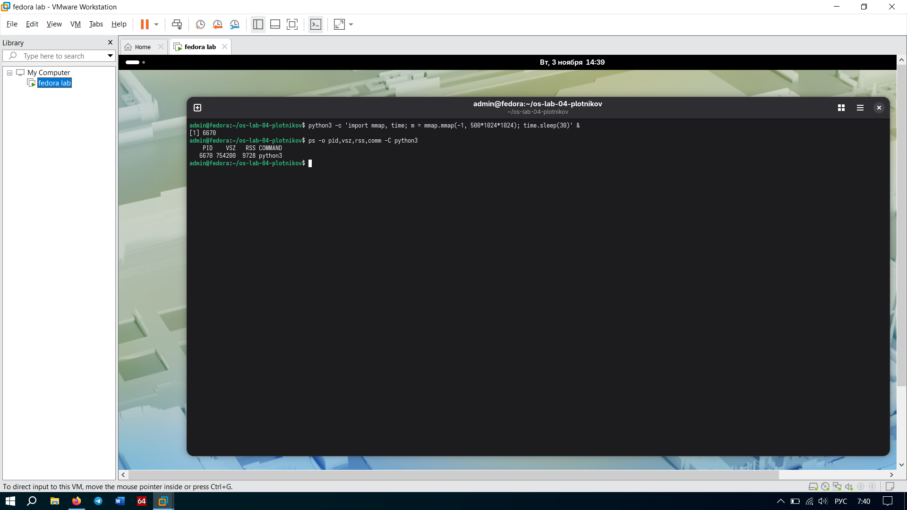
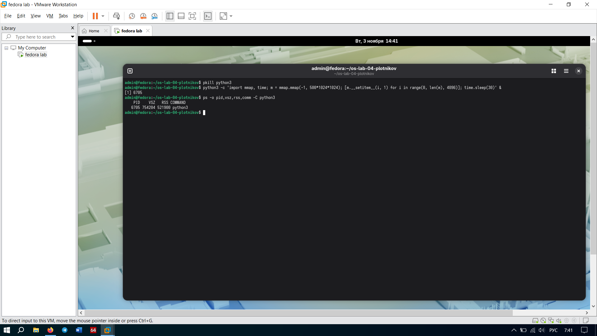

# Задание 2. RSS против VSZ

## Что мутили
Запустили питоновский скрипт, который через `mmap` просто зарезервировал 500 МБ, но ничего туда не записал. Вывод `ps` показал:
*   VSZ: **754200** КБ (огромный).
*   RSS: **9728** КБ (маленький, около 9.5 МБ).

Потом запустили второй скрипт, который прошелся по каждой странице памяти и записал туда байт. Вывод `ps` сразу изменился:
*   VSZ: **754204** КБ.
*   RSS: **521900** КБ (вырос почти до 500 метров!).

## Отвечаем на вопросы
**Почему у первого процесса RSS маленький, хотя VSZ большой?**
Потому что `mmap` просто забил виртуальные адреса (выделил место на бумаге), но физически страницы ОЗУ не выделил. Ядро выделяет реальную физическую память (RSS) только тогда, когда процесс пытается реально *записать* туда данные (принцип Demand Paging — страницы по требованию). Первый скрипт просто резервировал и спал, поэтому память не жрал.

**Как это связано с принципом «выделено ≠ занято»?**
Да это база. Прога может запросить хоть терабайт виртуальной памяти (VSZ), но реально физическую ОЗУ (RSS) она начнет занимать только тогда, когда начнет активно туда писать. Пока не пишешь — память не занята, она просто зарезервирована в виртуальном пространстве.

## Скриншоты

