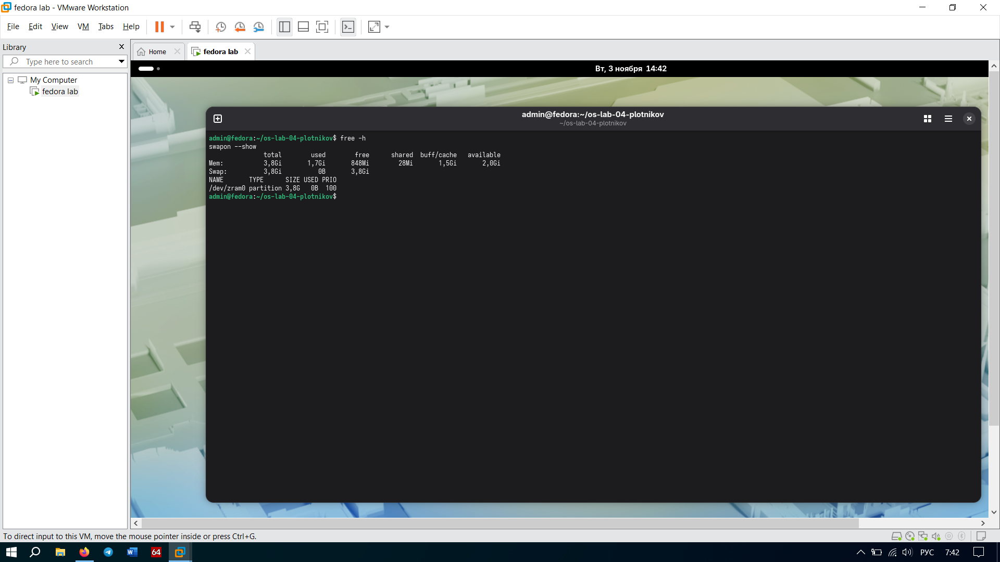
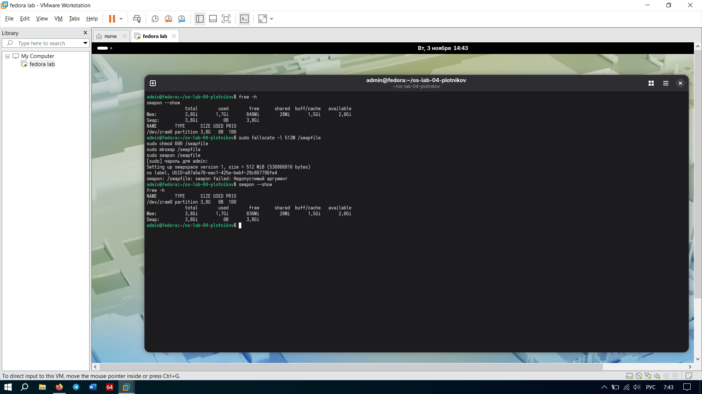
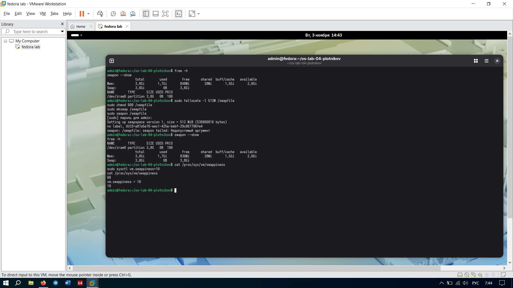

# Задание 3. Настройка подкачки (Swap)

## Что мутили
Сначала посмотрели, что было: команда `free -h` и `swapon --show` показали, что подкачки (Swap) в системе не было вообще (0B). 
Потом создали файл подкачки на 512 МБ и включили его. После этого `free -h` показал, что Swap появился, а `swapon --show` вывел путь к файлу `/swapfile` и его размер.
В конце поменяли параметр `swappiness` с 60 на 10 и отключили файл (сделали `swapoff` и удалили).

## Отвечаем на вопросы
**Что делает каждая из команд `fallocate`, `mkswap`, `swapon`?**
*   `fallocate -l 512M /swapfile` — быстро создает файл нужного размера (в нашем случае 512 МБ) на диске.
*   `mkswap /swapfile` — форматирует этот файл, чтобы ядро понимало, что это не просто текст, а область подкачки.
*   `swapon /swapfile` — активирует файл, то есть подключает его к системе как дополнительную оперативную память (на диске).

**Что такое swappiness и что означает значение 10 против 60?**
`swappiness` — это параметр (от 0 до 100), который говорит ядру, насколько агрессивно надо выгружать данные из оперативки (RAM) в подкачку (swap). 
*   `60` (значение по умолчанию) — ядро выгружает данные в swap как только RAM начинает заполняться.
*   `10` — ядро будет держать данные в RAM до последнего, и полезет в медленный swap только если оперативка вообще заканчивается. Это полезно для десктопов, чтобы система не тормозила.

**Почему для сервера базы данных swap иногда рекомендуют вовсе отключать?**
Потому что база данных (БД) — это прожорливая штука, которая постоянно работает с данными в оперативке. Если БД начнет скидывать данные в swap (на диск), а потом пытаться их оттуда прочитать, она будет тормозить в сотни раз (диск намного медленнее ОЗУ). Для БД лучше, чтобы данные всегда лежали в быстрой RAM. Если памяти не хватает — лучше уж пусть процесс упадет (OOM killer), чем сервер будет ползать из-за постоянных операций чтения/записи на диск (это называется thrashing).

## Скриншоты

